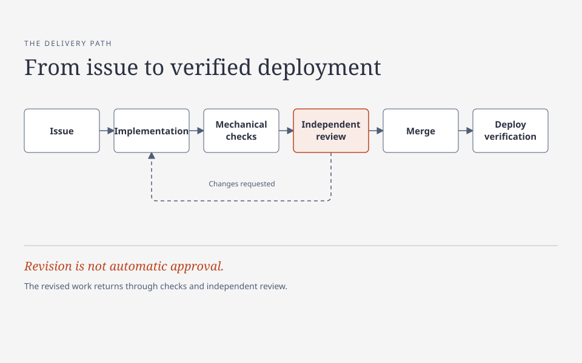

# Building with AI: A practical guide

AI can help a team design, implement, investigate, and review software. It cannot replace a clear task contract, deterministic checks, accountable decisions, or evidence from the actual system. This guide offers practices and bounded lessons to adapt to your own context; it does not claim that every practice applies everywhere. Its illustrations are fictional, not accounts of actual incidents or proof of production outcomes.

**Delivery path:** Issue → implementation → mechanical checks → independent review → merge → deploy verification. Requested changes return to implementation, followed by renewed checks and review.

[HTML diagram source](diagrams/delivery.html) (download and open locally to view or edit).

## Who this is for

This guide is for individual developers and small teams using AI to build and ship software. It assumes basic familiarity with code, Git, and pull requests; it does not assume experience with agent frameworks. Technical leads can also use it to agree on team boundaries and review practices.

- **Starting a project?** Read [technology choices](docs/technology-and-conventions.md), then [issues and delivery](docs/issues-and-delivery.md).
- **Reviewing a change?** Start with [verification and review](docs/verification-and-review.md), then [uncertainty and security](docs/uncertainty-and-security.md).
- **Coordinating agents?** Start with [knowledge and agents](docs/knowledge-and-agents.md) and [communication](docs/communication.md).
- **Handling failures or release risks?** Read [reliability and operations](docs/reliability-and-operations.md).

These are intended readers, not measured audience data. Adapt the practices to your project's risk and team.

## Read the guide

1. [Choose technology and conventions](docs/technology-and-conventions.md)
2. [Define work and completion](docs/issues-and-delivery.md)
3. [Verify and review changes](docs/verification-and-review.md)
4. [Maintain knowledge and coordinate agents](docs/knowledge-and-agents.md)
5. [Write clear agent messages](docs/communication.md)
6. [Handle uncertainty and security](docs/uncertainty-and-security.md)
7. [Recover safely and observe operations](docs/reliability-and-operations.md)
8. [Protect team quality](docs/team-quality.md)
9. [Learn from fictional illustrations](docs/case-studies.md)

## Working principles

- State the outcome and observable acceptance criteria before implementation.
- Select technology for the service and the team's ability to operate it.
- Use mechanical checks at commit, merge, and deployment boundaries. Use independent AI review for judgment; neither replaces the other.
- Treat code, tests, documentation, and deployment observations as different kinds of evidence.
- Give each piece of work one writer, an explicit scope, and a named decision owner.
- Keep communication short without omitting risks, uncertainty, or the next action.
- Obtain the required authorization before disclosing sensitive information.

## License

Material in this guide that the rights holder has authority to license is available under [Creative Commons Attribution 4.0 International (CC BY 4.0)](LICENSE). This license does not grant trademark or patent rights.

Some diagram content may be derived from third-party material under the MIT License; its copyright and permission notice is in [third-party notices](THIRD_PARTY_NOTICES.md). CC BY 4.0 does not replace those third-party terms or grant rights the licensor does not hold.
