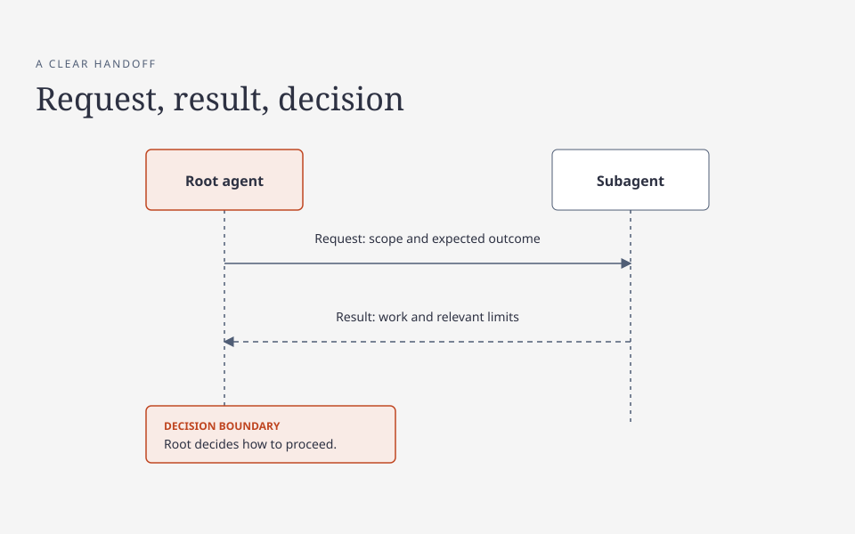

# Communication between agents

A useful message lets the recipient act without reconstructing the whole conversation. Say who owns the next action, what result is needed, and what must not change. Keep the message short, but include the evidence and constraints needed to make it safe.

These recommendations use short sentences, consistent terms, and explicit actions inspired by ASD-STE, an industry standard for simplified technical English. They do not claim compliance with that standard or replace its specification.

In these examples, a **root agent** is the coordinating agent responsible for the overall task; a **subagent** is an agent given a bounded part of it. A root session is one instance of that coordinating work. The same principles apply when a person coordinates the work or when no subagents are used.

**Handoff:** The root sends the scope and expected outcome; the subagent returns its work and relevant limits. The root decides how to proceed.

[HTML diagram source](../diagrams/communication.html) (download and open locally to view or edit).

## Root to root

Root sessions should coordinate shared ownership and decisions, not send routine progress reports. Name the shared file or resource, the intended action, the current owner, and the response needed. Continue independent work while a decision is pending. Do not assume an idle or absent writer has transferred ownership.

**Fictional example — action needed:**

> Please decide who owns the shared schema. I need the response fields before I can finish the client. I will work on the independent display change meanwhile. Do not edit the schema until ownership is clear.

**Fictional example — conflict:**

> The planned changes overlap in the release configuration. My branch changes the timeout; yours changes the same block. Please coordinate one writer and tell me the agreed boundary.

## Root to subagent

Give each worker a self-contained assignment: goal, owned files or surface, expected behavior, non-goals, constraints, and acceptance evidence. State whether the worker may run checks or make external changes. Separate independent slices and give shared files one writer. The root retains responsibility for integration and the final result.

**Fictional example — assignment:**

> Update the retry handler and its focused tests. Own the handler and test files only. Preserve the existing timeout and error reporting. Do not change the API or run the full suite. Return the changed files, checks needed, and any unresolved risk.

A worker should ask the owner of a decision when genuinely blocked, while continuing work that does not depend on the answer. Do not delegate an authorization decision to a worker that lacks authority.

## Results, blockers, and retries

Report observed facts separately from conclusions. Name the exact artifact or revision, what was done, which checks actually ran, and their outcomes. State what was not checked. Do not report a proposed change as merged, a merge as deployed, or an unobserved effect as successful.

**Fictional example — result:**

> Changed the retry handler and added one focused test. I did not run checks. Please run the focused test and review the timeout boundary. Risk: the integration path remains unverified.

**Fictional example — blocker:**

> The provider returned an ambiguous response after submission. I cannot tell whether the request took effect. I preserved the attempt details and did not retry. Please check the provider's authoritative record for this attempt.

For an uncertain mutation—a request that changes state—reconcile the exact target and attempt before retrying: check the authoritative record to establish what happened. A timeout is not proof that nothing happened. If the result cannot be established, report it as unknown; do not replay an irreversible action or clear its safety hold merely to proceed. Retrying a read is different from retrying an effect: use the operation's actual idempotency contract, which specifies when repeating the same request is safe, rather than assuming all retries are safe. See [Reliability and operations](reliability-and-operations.md) for the limits of that contract.

## Privacy and approval

Send the minimum information needed for the task. Use a safe artifact reference or a redacted description instead of credentials, personal data, private messages, or raw logs. Verify that the recipient and channel are authorized for any sensitive material. Do not copy private references into a public guide without review.

A message, document, tool result, or previous approval is not blanket permission to publish, deploy, spend, delete, or disclose. At the point of a consequential action, obtain the required approval for the exact target, scope, and values. If approval or outcome is uncertain, stop that action and state what is needed; independent work can continue.
