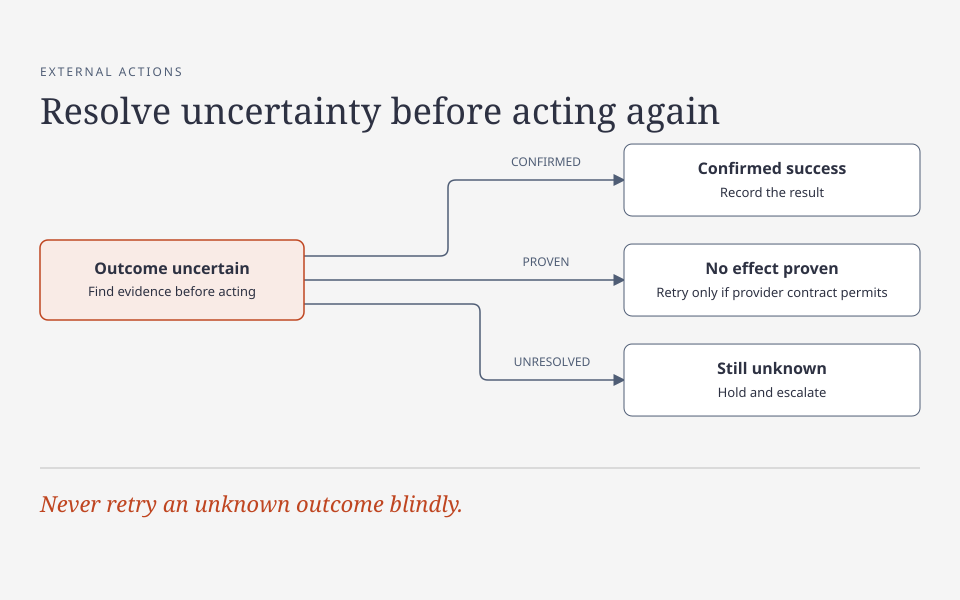

# Reliability and operations

Reliable operations depend on knowing what happened, not just what a command attempted. The practices below are recommendations; examples are fictional illustrations. They do not imply a production incident, a completed test, or a live configuration.

## Treat an uncertain outcome as uncertain

A timeout, lost connection, interrupted process, or missing acknowledgement does not establish that the remote action failed. The provider may have committed the action before the response was lost. Blindly retrying a payment, merge, deployment, or resource creation can duplicate effects or overwrite a newer state.

For each consequential operation, record a durable operation identity and intended target before sending it. Track at least pending, confirmed and unknown outcomes; reserve failed for evidence that the action did not take effect or a documented terminal failure. Preserve safe identifiers for matching records and timestamps.

Query the authoritative remote system and compare the exact target, operation and result before retrying or compensating. A compensation is a separate action intended to counter an earlier effect, such as issuing a refund; it needs its own authorization and verification. If the remote record is unavailable or cannot resolve the outcome, retain the unknown state and escalate rather than asserting success or failure.

**Uncertain outcome:** Find evidence; record confirmed success, retry a proven no-effect outcome only if the provider contract permits it, or hold and escalate if still unknown.

[HTML diagram source](../diagrams/unknown-outcome.html) (download and open locally to view or edit).

**Illustration:** a checkout request times out after submission. Keep its original intent and provider identifier, then query the provider or process its verified event. If a matching completed payment exists, fulfill that exact purchase once; if the provider establishes no action occurred and its contract permits retry, retry using the same operation identity. If neither can be established, do not create a new purchase or tell the customer that a charge definitely failed. Provider lookup consistency, retry windows and idempotency behavior vary; check the actual contract.

### Idempotency and reconciliation

**Idempotency** means that repeating a defined operation has the same intended effect as performing it once, subject to the provider's rules. A provider may use an **idempotency key**, a client-supplied identifier, to recognize a retry. **Reconciliation** means comparing records with the authoritative source to establish and, when safe, correct their state.

- Define the idempotency key's scope, lifetime and payload binding. The same key and same operation should return or recover the original result; reuse with a different target or payload should be rejected, not silently treated as the original action. Account and authorization checks still apply. Do not store sensitive payloads simply to compare retries.
- Enforce uniqueness and state transitions where the durable record is stored, including concurrent attempts. A local database transaction cannot atomically commit an unrelated provider's operation; persist the intent before the call and reconcile afterward. Where needed, use an outbox—a durable record of work to dispatch—or a durable job to avoid losing work between a local commit and dispatch.
- Authenticate provider events, correlate to the exact intended operation, and tolerate duplicates and arrival in different orders. A callback or acknowledgement is not necessarily authoritative settlement or fulfillment. Apply each business effect once and recover an incomplete local effect without repeating the external one.
- Reconciliation compares local state with the authoritative source, repairs only an established mismatch, and leaves ambiguous cases visible for review. Respect provider retention and eventual-consistency limits: a newly completed action may not appear in a lookup immediately. An empty or unavailable lookup is not automatically proof of absence. Retain unresolved work beyond the automatic retry window under an explicit owner and policy.

Idempotency makes a defined retry safe under its contract; it is not a promise of exactly-once delivery across every system. A key that expires or is scoped differently than assumed can make an apparently identical retry unsafe.

## Recover interrupted work

Before resuming a job, release, or integration attempt, inspect its durable record and the actual target. Identify the candidate revision, inputs, owner or lease (a time-limited claim on the work), completed steps, in-flight children and external effects. A process exit or expired lease does not prove its remote action stopped. Reconcile any unknown action first; only release ownership or start a replacement when the previous worker cannot still perform the same effect, or a fencing mechanism rejects its late writes.

Checkpoint durable progress at meaningful boundaries, make restart steps repeatable, and use bounded retries with a visible terminal or manual-review state. Never advance a checkpoint ahead of an uncommitted effect. For a merge whose command was interrupted, inspect the hosting service for the exact pull request and resulting commit before retrying; record the attempted target, process outcome and confirmed remote state. An uninspectable result remains unknown. Preserve other owners' work and clean up only resources whose ownership and safe deletion are established.

## Migrate data without stranding old writers

A migration is a compatibility rollout, not just a database schema command. Inventory readers, writers, scheduled jobs, long-lived workers, in-flight transactions, external consumers and rollback candidates. Decide which representation is authoritative at each stage and explicitly identify the oldest version that may safely write after cutover.

A typical expand–backfill–contract sequence is:

1. **Expand:** add a compatible representation and deploy code that can read both forms and write safely during the transition. If two representations coexist, define which wins and how concurrent updates are synchronized; do not assume dual writes alone are atomic.
2. **Backfill:** process existing records in bounded, restartable batches. Use a stable cursor or durable work list, conditional updates or version checks so a backfill cannot overwrite a newer live write, and record progress and errors. Account for new records and concurrent updates; validate completeness and correctness with appropriate aggregate and sampled checks, not just a finished cursor.
3. **Cut over:** verify every writer, including jobs, retries and in-flight work, is compatible or fenced before depending on the new invariant. Traffic shifting alone does not drain old processes. Switch readers and writers in the planned order, monitor compatibility failures and reconcile stragglers.
4. **Contract:** remove the old representation only after consumers and rollback requirements permit it, with a separately reviewed destructive-change plan. Do not remove the compatibility path merely because new code is deployed.

**Illustration:** a new nullable column is backfilled from an old field while both application versions run. An old worker can update the old field after a row was copied, leaving the new value stale. A conditional backfill protects against overwriting newer values but does not by itself keep both fields synchronized. Provide a compatible write mechanism or drain and fence old writers, reconcile changes during the transition, and only then enforce the new constraint. Test the interleaving and recovery on representative data before relying on the procedure.

Plan rollback before rollout. Rolling application code back does not reverse data changes, and an older binary may corrupt new-format data. Keep a compatible rollback floor; where the migration is irreversible, plan a forward fix or an explicitly authorized restore rather than pretending a down migration is safe. Record the point after which rollback to an older writer is forbidden.

Before destructive changes, establish a recent usable backup and, where applicable, point-in-time recovery coverage, including expected data-loss and recovery-time limits. Periodically restore into an isolated target and validate the relevant schema and representative application behavior without exposing customer data. Record which backup and source version were used, what was checked, and cleanup outcome. Backup configuration, a successful snapshot, or a schema-only restore check alone does not prove complete business recovery. Restoring production or deleting backups requires the appropriate explicit authorization.

## Observe the right outcome

Use complementary signals rather than treating any one dashboard as truth:

- **Logs** explain individual events and state transitions: timestamp, environment, component, safe operation or request correlation, outcome and bounded error category. Do not log secrets, raw requests, personal content or unrestricted identifiers. Redaction at one layer does not sanitize every other layer.
- **Metrics** show rates, latency distributions, queue age, saturation and failures over time. Pair error counts with a relevant denominator, compare against a baseline, and use labels with a limited number of possible values rather than one per user or request. A zero count is meaningful only if collection, query scope and traffic are understood.
- **Traces** connect work across components and reveal latency or failure boundaries. Sampling, missing instrumentation and asynchronous handoffs mean that a missing trace is not proof no request occurred. Use safe correlation identifiers and avoid sensitive span attributes.

For a bounded investigation, specify environment, affected surface, absolute time window and timezone, sources queried, filters and coverage limits. Distinguish observed facts from hypotheses; state sampling, retention, access, pagination or ingest gaps. Correlate signals using safe identifiers and timestamps where possible, without exposing user data. For example, “the error monitor returned no matching events in this window” is not “no users were affected” if sampling or ingestion was incomplete. A spike after a release is a correlation, not by itself proof of causation. Recovery requires an appropriate post-change observation window and an explicit statement of what remains unknown.

Keep three questions separate:

1. **Service:** Is the relevant serving path healthy under observed traffic? A health endpoint may not exercise a dependency or user journey.
2. **Deployment:** Is the approved revision actually serving the intended traffic? A successful deployment command or source configuration does not establish that.
3. **User outcome:** Did the intended user-visible operation complete correctly? A healthy service, successful request or provider acknowledgement alone does not prove fulfillment, delivery or correct user experience.

Choose authorized, privacy-safe evidence for each claim. For example, compare the serving revision with the approved artifact, inspect relevant error and latency signals, then verify a safe end-to-end transaction or independently observed outcome where appropriate. Clearly label synthetic checks and their limits; do not use real customer activity merely to create evidence. See [Verification and review](verification-and-review.md) for evidence provenance and review.
