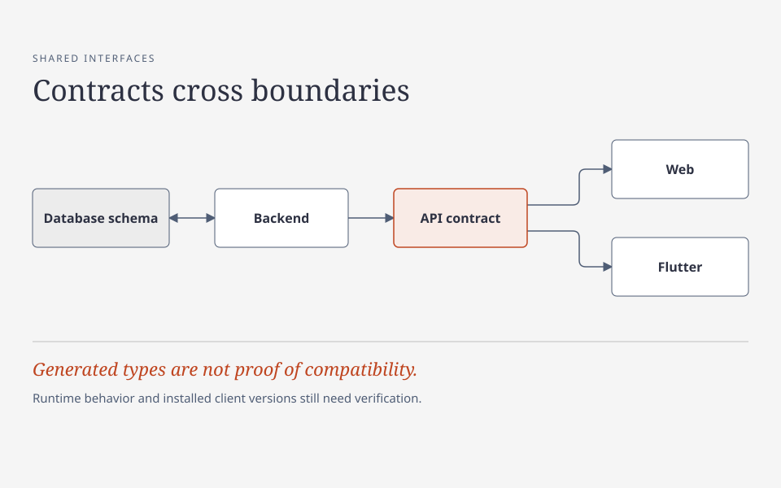

# Technology choices and conventions

AI can produce plausible code in almost any stack. That makes a clear boundary more valuable, not less: specify who owns the data, which contracts must remain stable, and how a change will be checked before asking for an implementation. The guidance below is a set of recommendations, not a claim that one stack is best for every product.

**Start here:** identify the data owner, affected consumers and compatibility constraints for the change. Use the boundary table to choose what to inspect and test; apply the language guidance for the parts you actually touch.

## Choose for the service, not for fashion

Start with the service's workload and constraints: latency and throughput, state and consistency, deployment environment, platform support, security, operating cost, team experience, and the difficulty of replacing a dependency. Choose the simplest existing tool that meets those needs. A short-lived administrative script, a deterministic calculation engine, a public web app, and a mobile client need not share a language or runtime. Conversely, another language or provider adds build, operational, and integration costs; introduce it for a concrete benefit.

For example, a CPU-heavy, correctness-sensitive calculation service may benefit from Rust's type system and predictable resource use. A React and TypeScript client may suit an interactive browser interface; Flutter may suit a shared mobile interface where its platform tradeoffs are acceptable. Python is useful for bounded tooling and data work; shell is useful for composing existing commands. These are examples, not universal performance or productivity guarantees. Measure real workloads, including startup time, memory, cold starts (starting an inactive service), and external calls, before optimizing or moving a service.

Select infrastructure in the same way. Managed services can reduce routine operations but add provider dependencies and failure modes; self-hosting buys control at the cost of maintenance and incident response. Compare data residency, recovery, scaling limits, identity, network access, logs, cost, and exit options. Keep credentials out of source and logs, grant the least access needed, and test recovery as well as deployment. Pin tools and artifacts where reproducibility matters, then plan security updates: a pin also freezes old vulnerabilities. A checksum detects changes against the recorded digest; it does not authenticate an untrusted original download.

## A working stack and agent workflow

One project's repository uses a multi-language monorepo (one repository containing multiple projects):

| Area | Tools and role |
| --- | --- |
| Backend and domain code | Rust |
| Web applications | TypeScript and React |
| Mobile applications | Dart and Flutter |
| Some edge workers | TypeScript and Cloudflare Workers |
| Development and automation | Bun and Python |

This combination reflects different responsibilities, not a universal recommendation. Type safety and predictable resource use can support a correctness-sensitive backend; established UI ecosystems can support web and mobile clients. Those are reasons to evaluate a tool, not proof of why every past choice was made or that it is the best choice for another service.

The project also documents OMP, a separate host for coding and AI agents, not part of the deployed application. Its described workflow separates agent responsibilities and handoffs, mechanical checks, independent review, and approval for consequential actions. Repository documentation describes intended boundaries; it does not establish which host settings, integrations, permissions, or versions are active now. Do not publish raw configuration, credentials, private paths, session data, or access grants as a shortcut to explaining a workflow.

## Boundaries before style

- Put business calculations in a deterministic core when practical; pass inputs in and keep network, database, environment, and filesystem access at the edges. This makes failure handling and tests clearer. It does not mean every function needs a new layer.
- Give each concept and piece of state an owner. Derive a boolean such as “has a profile” from the authoritative profile state instead of keeping a second independently updated copy. Preserve loading and error states; unavailable is not the same as false or zero.
- Generate client types from the owning contract where that is the established practice. Do not edit generated files as the source of truth or create a handwritten parallel data-transfer object (DTO), a type used to carry data across a boundary. Regeneration does not update already-installed clients: check old and new servers, supported clients, persisted data, and rollout order before changing a wire contract (the format exchanged between systems).
- Treat omitted fields and explicit `null` as distinct when the API requires it. A nullable Dart field alone does not prove its serializer preserves that distinction; inspect the generated serializer. Likewise, do not omit `false` or `0` using a truthiness check on query parameters.
- Reuse existing design tokens (shared visual values), accessibility patterns, localization ownership, and shared packages. Share a component only when its contract and dependencies fit both consumers; importing another app's internal tree can create accidental release coupling.

## Define contracts at every boundary

Preventing type errors is not the whole goal. Define each boundary's contract and verify compatibility through its real consumers.

**Contracts:** Database schema ↔ backend → API contract → web and Flutter. Generated types alone do not prove runtime behavior or installed-client compatibility.

[HTML diagram source](../diagrams/contracts.html) (download and open locally to view or edit).

| Boundary | Contract and mechanical checks | Consumer risks to exercise |
| --- | --- | --- |
| Database → backend | Make reviewed migrations authoritative for schema changes; check queries and model mappings against the migrated schema where tooling permits. | Nullability, constraints, enum values, numeric ranges, existing data, transactions, and rollback limits. |
| Backend → web | Own the API schema with the producer; generate TypeScript clients and types from it and check that generated files are current. | Actual JSON and error responses, runtime validation, omitted versus null fields, and supported older clients. |
| Backend → Flutter | Generate Dart clients and types from the same API contract and check their freshness separately. | Actual serialization and decoding, dates, enums, absent versus null properties, and supported installed app versions. |

For a contract change, identify affected queries, producers, generated artifacts, clients, tests, and stored payloads. Regenerate from the owning contract rather than editing generated files, and exercise the actual request and response paths for each affected consumer. Include negative and boundary cases: a type declaration or successful generation does not prove that runtime data or an existing client conforms.

Plan rolling changes across old and new server revisions and supported web and mobile clients. For example, add a compatible field first, deploy readers and writers in an order that supports both versions, backfill existing data if needed, and remove the old representation only after the supported clients and stored data no longer depend on it. A repository's regenerated client does not update an app already installed on a device.

## Language-specific guidance

These are review prompts, not substitutes for each repository's edition, supported versions, formatter, linter, and established patterns.

### Rust

Model meaningful states with types and return `Result` for recoverable failures. Borrow by default; avoid cloning large values merely to satisfy an unclear ownership design. Use `unsafe` only when necessary and document the invariants that make it sound. In async services, do not run blocking I/O or long CPU work on executor threads, and release locks before awaiting when they are no longer needed. For example, copy the small data needed from a guard, drop the guard, then make the network request. Do not replace a failed calculation with a plausible default unless that default is part of the explicit domain contract.

### TypeScript and React

Keep API boundary validation separate from static typing: a type assertion does not validate JSON from a server. Prefer generated contract types and discriminated unions over `any` and hand-maintained response shapes. Render loading, empty, error, and success states explicitly. Derive render values rather than copying props into state without a reason, and use effects for synchronization with external systems, not as a default way to compute state. Clean up subscriptions and account for stale asynchronous results. Use semantic controls and accessible labels rather than clickable generic containers.

### Dart and Flutter

Follow the project's analyzer and generated-client conventions; use explicit types, `final` where appropriate, and `const` where it makes sense. Handle futures deliberately: await work whose result or error matters; use `unawaited` only when the work is intentionally detached and errors have an owner. Check widget lifecycle before updating UI after an await, and dispose controllers and subscriptions. Derive view state from its authoritative provider instead of duplicating it. Do not add local persistence or offline behavior just because the framework permits it; those change the product's data and synchronization contract.

### Python

Use a pinned interpreter and dependency environment for project tooling. Keep scripts focused, use `pathlib` or standard library facilities when they fit, and surface failures with enough context for an operator to act. Avoid mutable default arguments and broad `except Exception` blocks that turn a failed operation into apparent success. For long-running async programs, move blocking work off the event loop. Never build a shell command by concatenating untrusted input; pass an argument list to `subprocess` when invoking a program.

### Shell

Use shell for orchestration, not intricate data parsing. Quote expansions, use arrays for argument lists in Bash, and check errors at the operation where they matter; `set -e` alone has context-dependent behavior and is not a complete error strategy. Avoid parsing filenames with `ls`, assuming the working directory, or using unquoted globs for destructive operations. Keep secrets out of command traces and output. For example, explicitly check that a cleanup target is the intended nonempty directory before deleting its contents; do not use a fallback that could expand to a broader path.

### SQL

Bind values as parameters rather than interpolating user input. Parameters do not generally stand in for identifiers: select a table or sort column from an explicit allowlist instead. Define constraints in the database for invariants the database owns, and use transactions when changes must commit together. Review query plans and indexes against representative data rather than adding indexes by habit; every index has write and storage costs. Plan schema changes for old and new application versions during rolling deployment, including backfill, rollback limits, and any old writers that must drain.

### Infrastructure and deployment

Keep infrastructure definitions and tool versions reviewable; avoid undocumented console-only drift where the platform allows declared configuration. Separate secrets from configuration and distinguish a configuration file from evidence of the live permissions or deployed state. Review a plan's scope and potential data loss before applying it. Build and verify the intended artifact, deploy the approved version without unnecessary downtime, and check the actual serving result. A green build or merged change is not proof of deployment; provider-connected behavior and disaster recovery need their own evidence.

## Making these conventions useful with AI

Give the assistant the relevant local conventions, source-of-truth contract, expected behavior, and affected consumers. Ask it to identify existing patterns and failure cases before proposing a change. Mechanical checks can enforce selected rules at commit, merge, and deployment boundaries; they cannot establish all product, security, or compatibility judgments. Use AI and human judgment throughout development, including PR review, and inspect actual results rather than treating generated code, a passing check, or an agent's summary as proof of behavior.
